<p align="center">
  <picture>
    <source media="(prefers-color-scheme: dark)" srcset="docs/brand/logo-dark.svg">
    
  </picture>
</p>

<p align="center">
  <strong>A real-time social app: follow people, share posts, chat live and build communities.</strong><br>
  Next.js · Express · PostgreSQL · MongoDB · Socket.io
</p>

<p align="center">
  <a href="https://github.com/rojanaugustine999/connectspace/actions/workflows/ci.yml"></a>
</p>

<p align="center">
  <a href="https://connectspace-opal.vercel.app"><strong>Live demo</strong></a> ·
  <a href="docs/CASE_STUDY.md">Case study</a> ·
  <a href="docs/API.md">API reference</a> ·
  <a href="DEPLOY.md">Deployment guide</a>
</p>

<p align="center">
  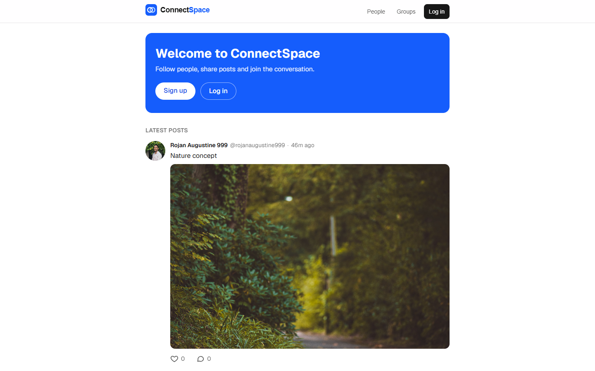
</p>

> **Try it:** log in as `alice@demo.test` / `password123` (a shared demo account; anything you post is public).
> The API runs on a free plan that sleeps when idle. A [scheduled GitHub Action](.github/workflows/keep-alive.yml) keeps it awake, and if it ever does sleep, the site shows "Waking up the server…" and loads by itself.

## Features

- **Accounts:** sign up, log in, profile photo and bio, and **delete your account** with everything in it (password required). Passwords hashed with bcrypt; JWT in an `httpOnly` cookie
- **Social graph:** follow and unfollow, followers/following lists
- **Search:** people by name or @username, and posts by word (MongoDB text search, best match first, matching words highlighted; private group posts only for members)
- **Feed:** posts from people you follow, with **infinite scroll**, photos (up to 4), likes, threaded comments, and editing your own posts (with an "edited" label)
- **Real time:** one-to-one chat with **typing indicators** and **read receipts**, plus **live notifications**, **@mentions** with suggestions as you type, and unread badges (Socket.io)
- **Groups:** public or private, owner/admin/member roles, join requests, group-only posts
- **Light and dark themes:** built on [design tokens](docs/design-tokens.json) shared with Figma; follows the device setting, or pick one in the account menu
- **Fast first paint and link previews:** for logged-out visitors, the first posts are rendered on the server; shared post and profile links show their own title and photo
- **Production details:** per-visitor rate limiting, private content hidden as 404, image type checks, graceful shutdown
- **Tested:** 57 automated API tests (real HTTP and Socket.io clients against real databases) run on every push in [GitHub Actions](.github/workflows/ci.yml)
- **Audited:** Lighthouse accessibility 100, and phone performance 99–100 on the home, profile and post pages of the live site, 0 axe issues in light and dark mode ([before and after](docs/CASE_STUDY.md#measuring-it-an-accessibility-and-speed-audit))

## Screenshots

### Real-time chat: one conversation, two people

**Your view:** your message shows "Seen" as soon as Alice opens the chat.
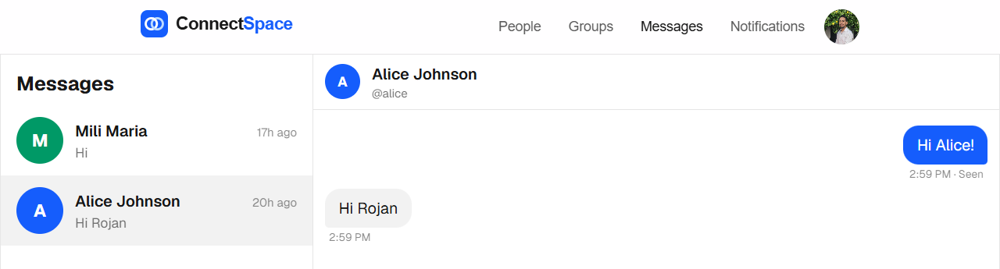

**Alice's view, in another browser:** the same messages arrive live, with no refresh.
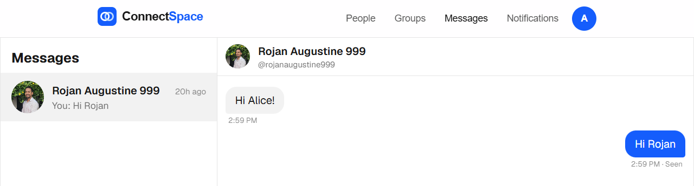

### Logged in

| Home feed | People you follow |
|---|---|
| 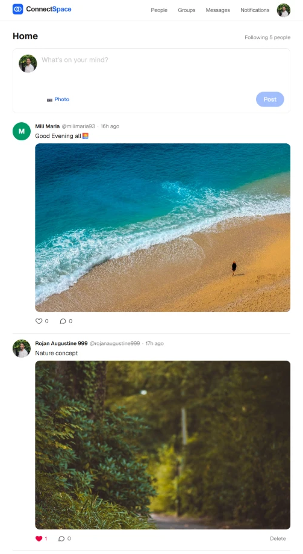 | 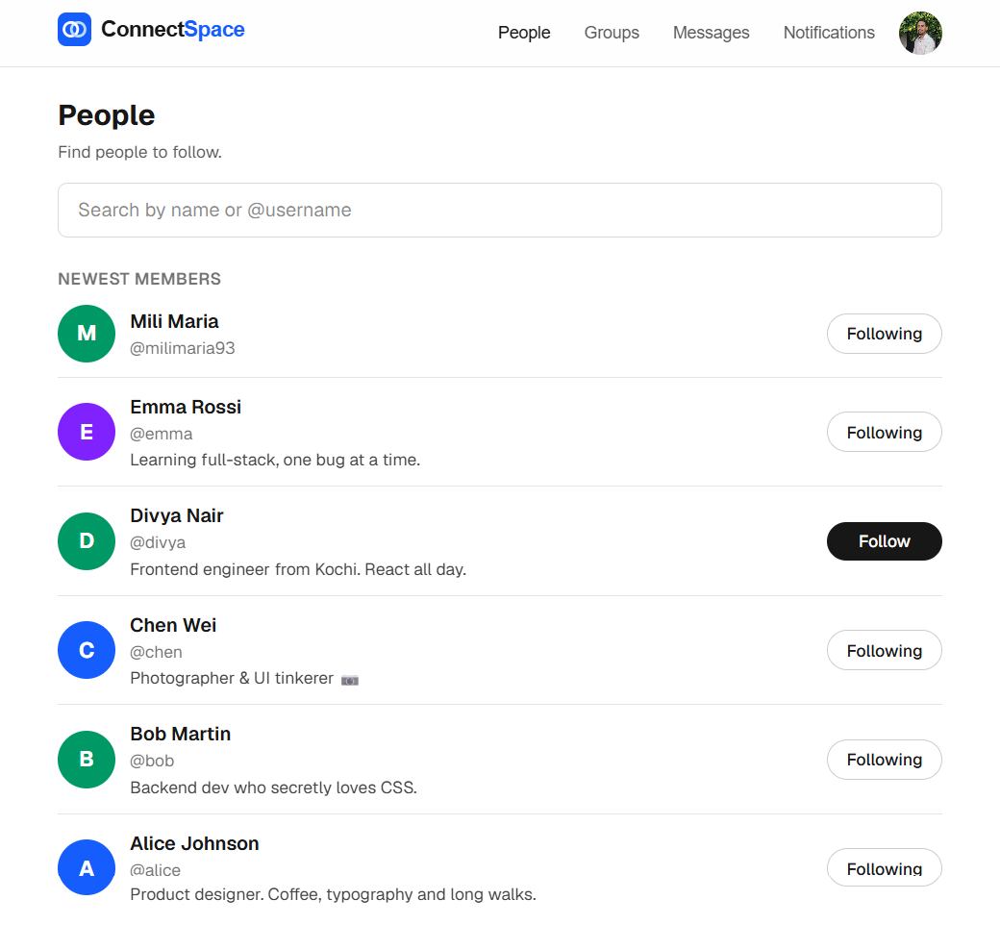 |

| Live notifications | Your profile |
|---|---|
| 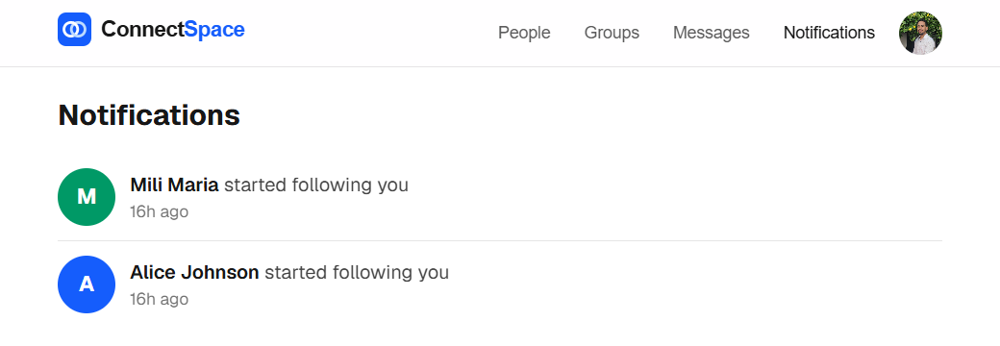 | 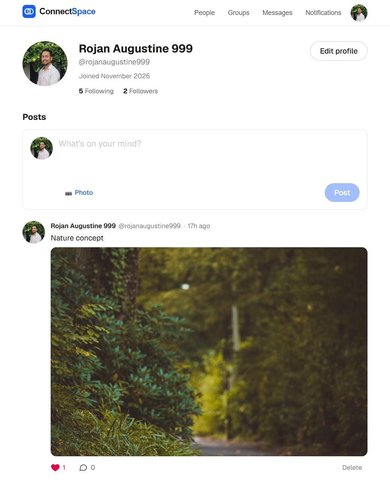 |

### Search posts and people

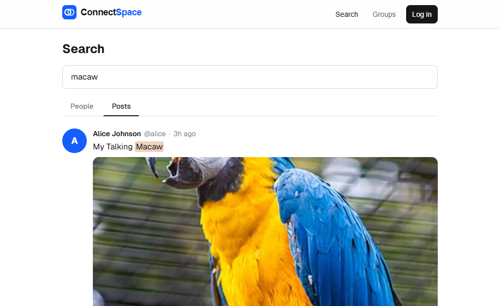

### Dark mode and @mentions

| Dark mode (follows your device, or pick it in the account menu) | Typing "@" suggests people to mention |
|---|---|
| 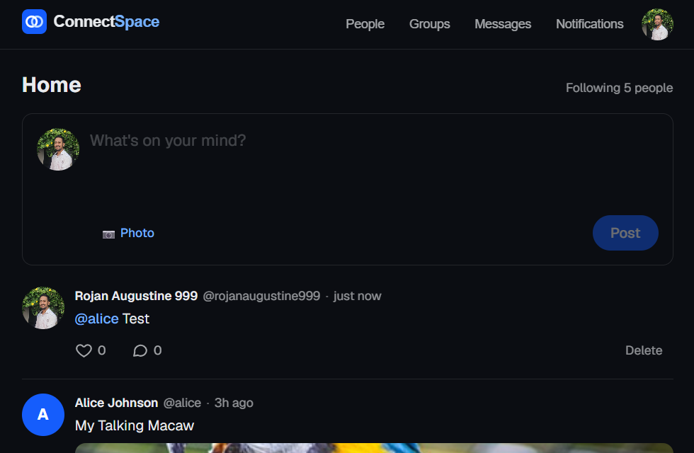 | 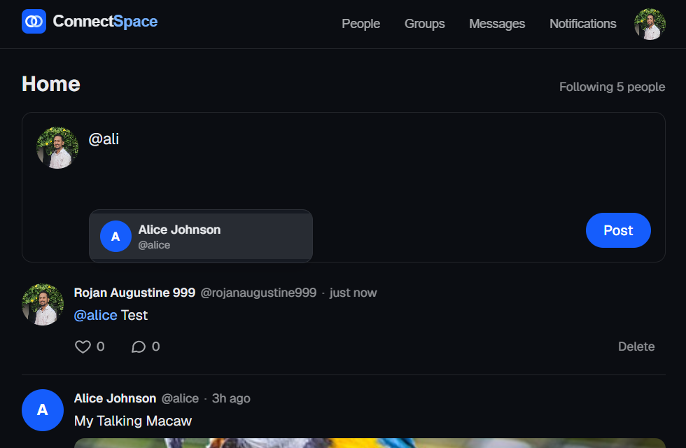 |

### Logged out and on a phone

| A public profile | Sign up | On a phone |
|---|---|---|
| 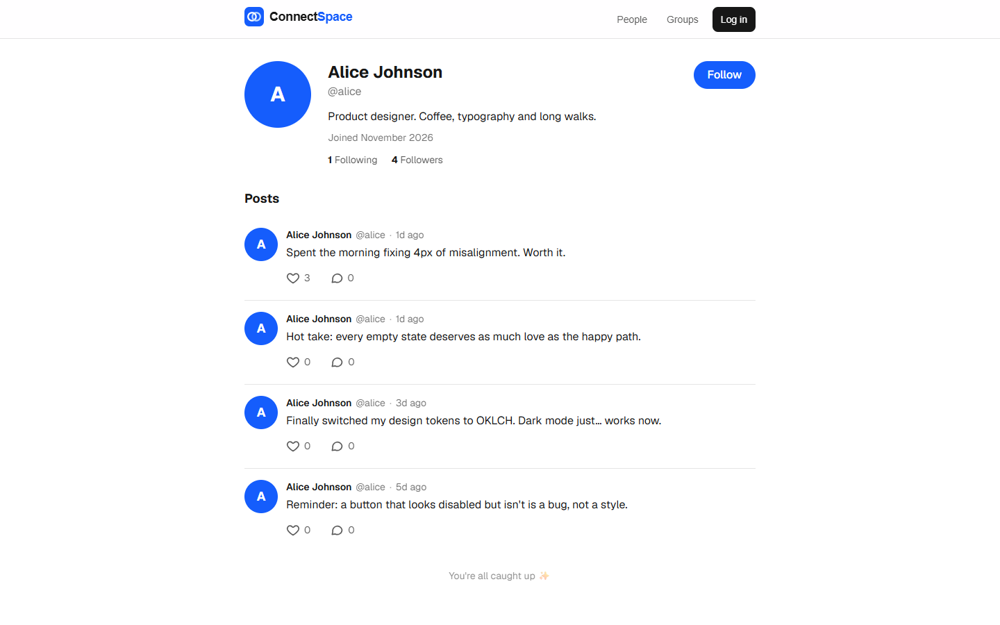 | 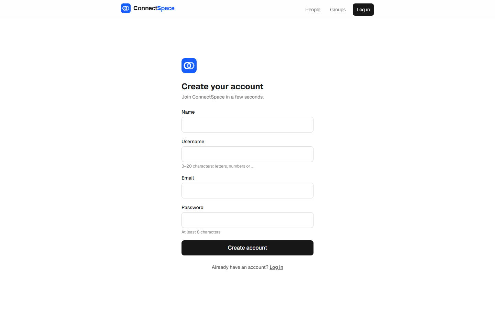 | 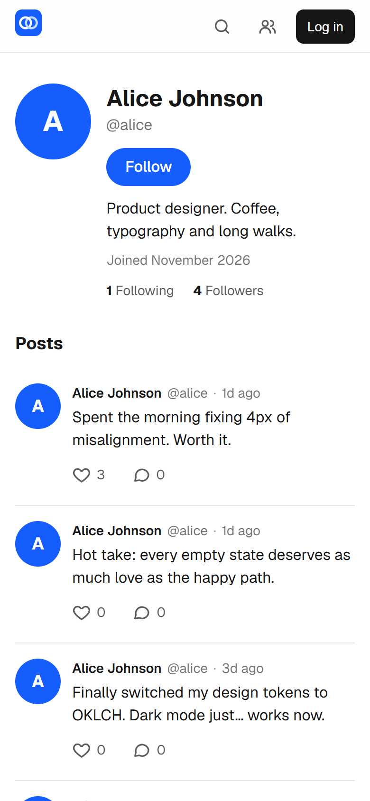 |

## Architecture

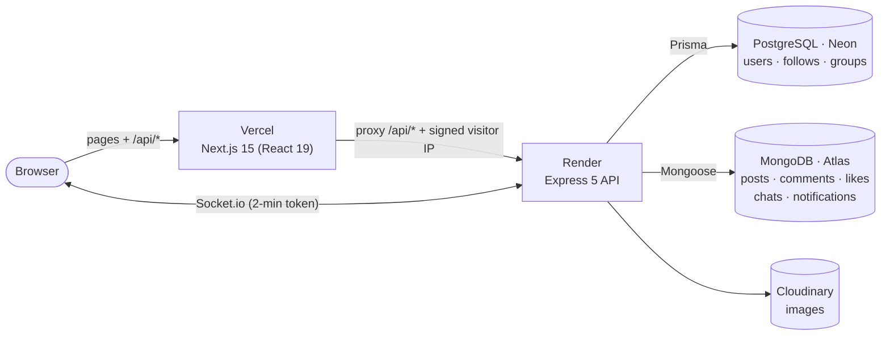

- The browser only talks to **one site** (Vercel). Next.js forwards `/api/*` to Express, so the login cookie is first-party and works in Safari.
- **Socket.io** can't go through that proxy, so it connects straight to the API with a short-lived token fetched through it.
- **Two databases, each for what it's good at:** PostgreSQL for relationships that need strict rules, and MongoDB for high-volume, flexible documents. The API merges them (no cross-database JOIN), always with a fixed number of queries.

### A request, step by step

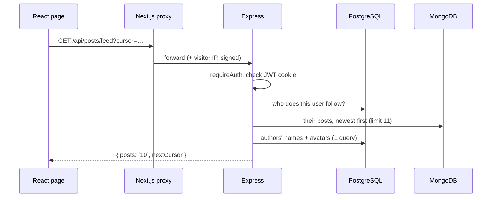

## Tech stack

| Layer | Tools |
|---|---|
| Frontend | Next.js 15 (App Router), React 19, Tailwind CSS 4 |
| API | Node.js, Express 5, Zod validation, Socket.io, Multer |
| Data | PostgreSQL + Prisma 6 (Neon), MongoDB + Mongoose (Atlas), Cloudinary |
| Security | bcrypt, JWT (`httpOnly` cookie), Helmet, express-rate-limit |
| Hosting | Vercel (website), Render (API, `render.yaml` blueprint) |

## Engineering highlights

| Problem | Solution |
|---|---|
| Two likes at the same moment | Unique index `{ postId, userId }` + atomic `$inc` counter |
| Posts skipped while scrolling | Cursor pagination on `createdAt` **and** `_id` |
| Feed queries growing per post (N+1) | Load authors and "liked by me" for a whole page in one query each |
| Private group posts leaking | Every read, like and comment path checks access; outsiders get 404 |
| Fake uploads | Check the file's real bytes (magic numbers), cap at 5 MB, random file names |
| Rate limits shared by everyone behind proxies | Proxy signs the visitor IP with a shared secret; hop count measured |
| Chat "Sending…" bubbles duplicating | Client-generated `clientId` echoed by the server |

The full story, from a UI/UX point of view, is in the **[case study](docs/CASE_STUDY.md)**.

## Run it locally

You need Node.js 20+, a PostgreSQL database and a MongoDB database (the free tiers of [Neon](https://neon.tech) and [Atlas](https://www.mongodb.com/atlas) work).

```bash
git clone https://github.com/rojanaugustine999/connectspace.git
cd connectspace
```

```bash
cd server
cp .env.example .env          # fill in DATABASE_URL, MONGO_URI, JWT_SECRET
npm install
npx prisma migrate deploy     # create the PostgreSQL tables
npm run db:seed               # demo users, follows, posts and likes
npm run dev                   # API on http://localhost:5000
```

```bash
cd client
cp .env.example .env.local
npm install
npm run dev                   # website on http://localhost:3000
```

Open http://localhost:3000 and log in as `alice@demo.test` / `password123`.
http://localhost:3000/status shows whether the API and both databases are connected.

### Tests

The API tests live in `server/tests` and run on every push (see the CI badge). GitHub Actions starts throwaway PostgreSQL and MongoDB databases, so your real data is never touched. To run them locally you need your own local test databases: copy `server/.env.test.example` to `server/.env.test`, then run `npm test` in `server`. The tests refuse to start if the databases aren't on localhost.

## Project structure

```
client/                 Next.js website
  app/                  pages (feed, profiles, posts, messages, groups, settings…)
  components/           PostCard, ChatWindow, FollowButton, Logo…
  lib/                  api helper, auth + socket contexts
  middleware.js         passes the signed visitor IP to the API
server/                 Express API
  prisma/               PostgreSQL schema, migrations, seed script
  src/routes/           URL → middleware → controller
  src/services/         business logic (feed, chat, groups, uploads…)
  src/models/           MongoDB models
  src/socket/           Socket.io: login, chat, typing, live events
docs/                   case study, API reference, screenshots, brand
render.yaml             Render blueprint for the API
```

## Documentation

- **[Case study](docs/CASE_STUDY.md):** design goals, decisions and lessons learned
- **[API reference](docs/API.md):** REST routes, Socket.io events and error codes
- **[Usability test kit](docs/usability-test/README.md):** script, tasks, notes sheet and findings template for a 5-person test
- **[Deployment guide](DEPLOY.md):** Neon, Atlas, Cloudinary, Render and Vercel, step by step

## Credits

Designed and built by **[Rojan Augustine](https://github.com/rojanaugustine999)**, a UI/UX designer and frontend developer learning the full stack, with Claude (Claude Code) as a pair programmer.
