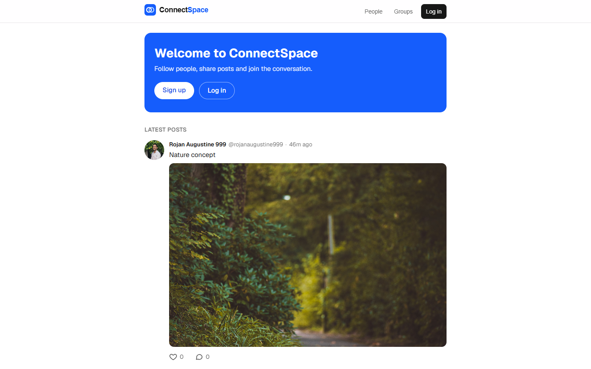
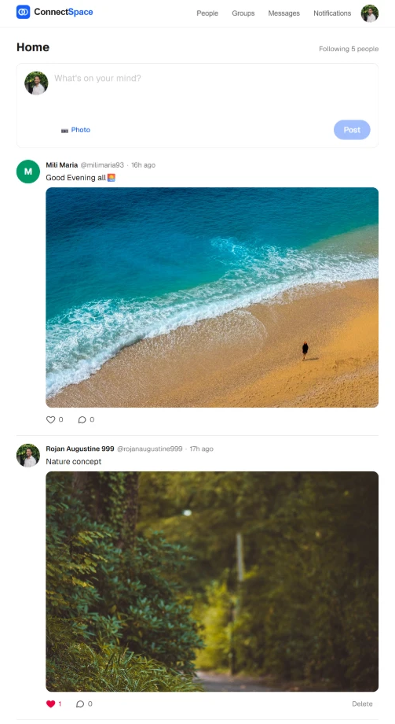
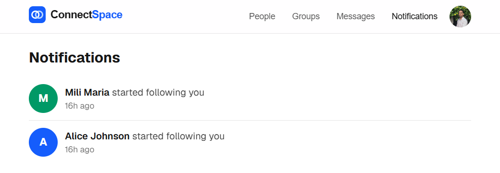
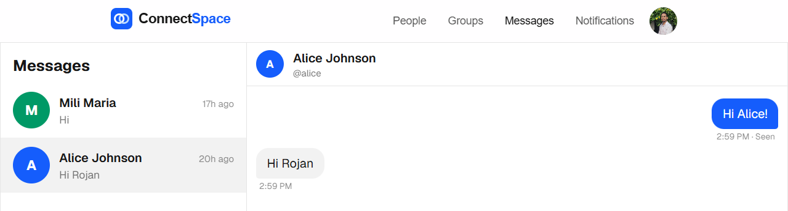
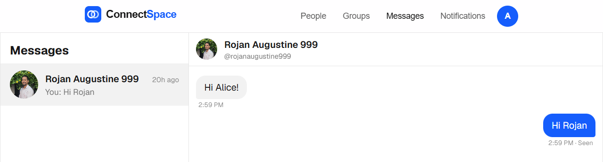
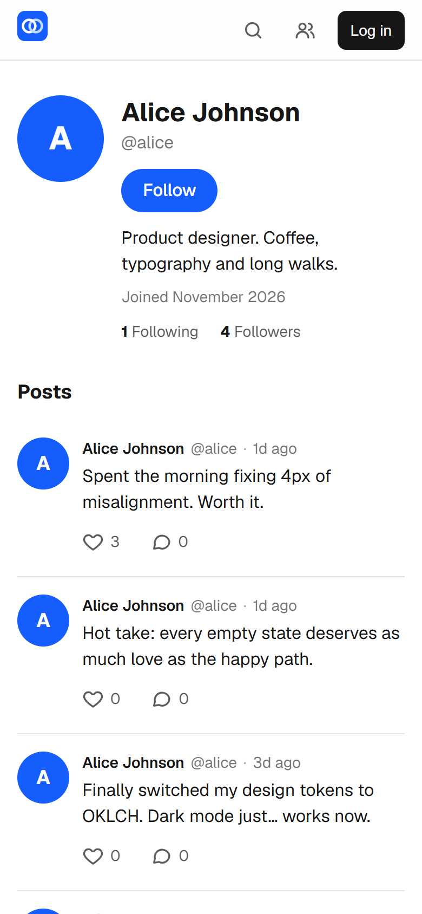
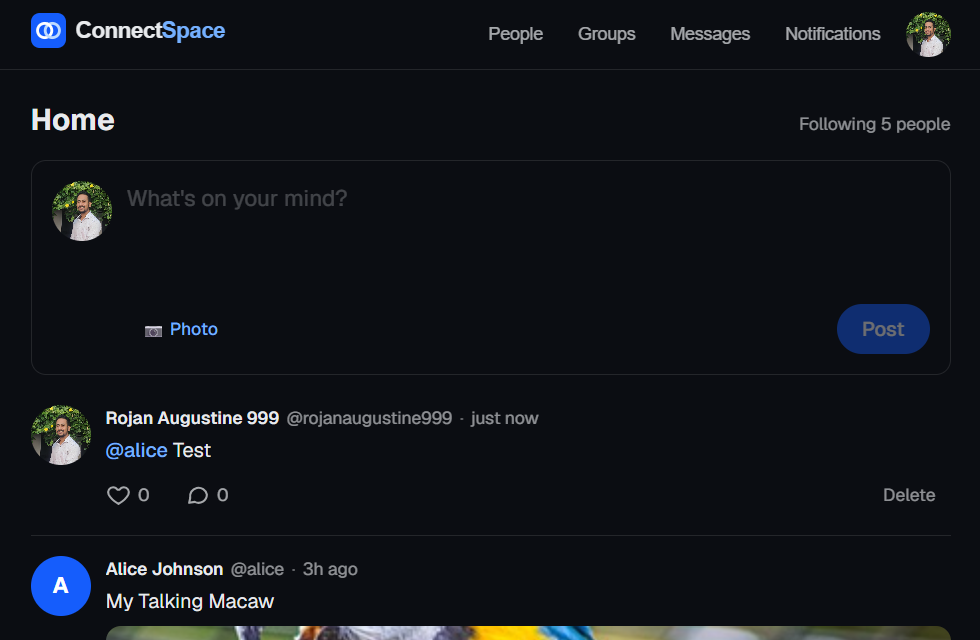
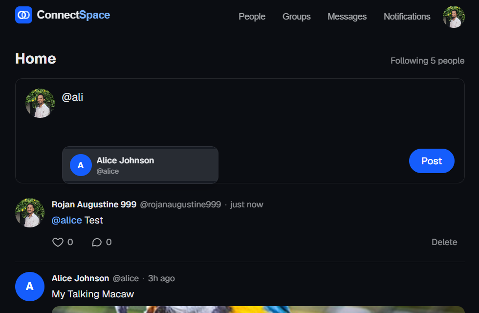
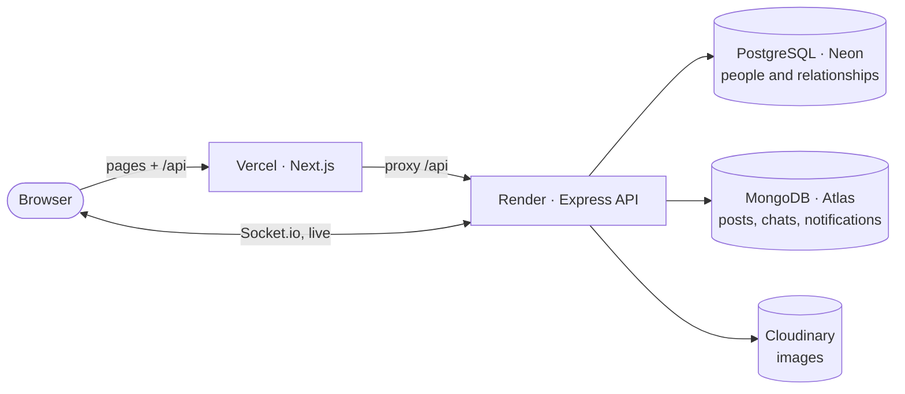

# Case study: ConnectSpace

> **A designer learning the backend by building a real-time social app end to end.**
> Role: product design, frontend and backend · Built: November 2026 · [Live site](https://connectspace-opal.vercel.app)

## Why I built it

I'm a UI/UX designer and frontend developer. My earlier projects ([TripNest](https://tripnest-travel-booking-platform.vercel.app/), [Amazon product listing](https://amazon-product-listing-roj.vercel.app/)) were interfaces on top of fake data. I wanted to understand what happens **behind the screen**: where data lives, how a login really works, and what makes "real time" real.

So I set myself one constraint: **every interaction must be backed by a real server and a real database, and deployed for anyone to use.**

## Goals

| For people using it | For me as a learner |
|---|---|
| Feel instant, even on a slow connection | Design a database, not just a screen |
| Never hit a dead end (empty, error and loading states) | Learn REST, auth, WebSockets and deployment |
| Work equally well on a phone | Make deliberate trade-offs and explain them |
| Keep private things private | Ship something people can actually use |

## Design principles, and how the backend made them possible

### 1. Feel instant

| Home feed | Live notifications |
|---|---|
|  |  |

**The same chat in two browsers:** my message is marked "Seen" the moment Alice opens it.

Likes, follows and chat messages update the UI **before** the server answers (optimistic UI) and roll back if the request fails. The design idea needed backend support: likes use an atomic `$inc` plus a unique index, so double-taps can't double-count. Chat messages carry a `clientId`, so the "Sending…" bubble is swapped for the saved message without duplicates.

### 2. Never a dead end
Every list has three designed states: **loading** (skeletons, not spinners), **empty** (an invitation: "Find people to follow", not "No data"), and **error** (a message plus **Try again**). Failed chat messages show **Not sent: Retry** in place. The API sends human-readable errors, so the UI can show them as they are.

### 3. Accessible by default
- The Follow button is a real toggle (`aria-pressed`) with a stable label ("Follow @alice"). Its "Unfollow" hover text only appears on devices with a mouse, because a tap on a phone would leave it stuck.
- Form errors are linked to their inputs (`aria-invalid` and `aria-describedby`), and unread badges include screen-reader text ("3 unread").
- Phone nav icons are labelled links, not decorative emoji.
- The account menu on the avatar (View profile, Edit profile, Log out) follows the WAI-ARIA menu button pattern: Enter opens it and focuses the first item, arrow keys move and wrap, Escape closes it and returns focus to the avatar.

### 4. Mobile first

| Profile on a phone | Home on a phone |
|---|---|
|  |  |

Messages switch from two panes (desktop) to list → chat (phone). The nav collapses to the logo mark plus line icons.

### 5. One visual language
One accent blue, one icon style (2px line icons), one avatar component that shows the person's photo or a colour taken from their username, so the same person always gets the same colour.

### 6. Colours as design tokens, so dark mode is free
Components never use raw colours. They use named tokens like `surface`, `line`, `link` and `danger`, and light and dark are two sets of values for the same names. The site follows the device setting, and the account menu lets people choose Auto, Light or Dark (saved on their device and applied before the page paints, so there's no white flash). The same tokens are exported to [design-tokens.json](design-tokens.json), ready to import as Figma variables with a light and a dark mode, so design and code share one source of truth.

| Dark mode | @mention suggestions |
|---|---|
|  |  |

The @mention list is an accessible combobox: arrow keys move through people, Enter picks one, Escape closes it, and screen readers hear who is highlighted. On the server, only real usernames count, and in a private group only members are notified, so a notification never reveals a post someone can't open.

## The brand

 **Two interlocking rings: two people, one shared space.**

I compared three concepts (an orbiting "C", a chat bubble with nodes, and overlapping rings) and tested each at **16 px**, where favicons live. The rings were the calmest and most recognisable small. Interlocking them like chain links turned "overlap" into "connected". The mark comes as a browser tab icon, phone home-screen icon and a 1200×630 social preview image.

## Architecture, explained simply

**Why two databases?** People and their relationships (follows, group roles) need strict rules: no duplicate follows, one owner per group. That's what **PostgreSQL** is built for. Posts, comments, chats and notifications are high-volume, flexible documents, which suits **MongoDB**. The trade-off: the two can't JOIN, so the API fetches posts from MongoDB, then their authors from PostgreSQL **in a single query**, and merges them.

## Problems I hit, and what they taught me

| What I saw | What was really happening | Fix |
|---|---|---|
| MongoDB wouldn't connect on Windows | My router refused the special DNS lookup Atlas uses | Point Node at public DNS for that lookup |
| Some posts never appeared while scrolling | Posts with the **same timestamp** were skipped by the page cursor | Cursor of `createdAt` **plus** `_id` |
| "Typing…" sometimes got stuck on | "Stopped typing" overtook "started typing" on the server | Process each user's typing events in order |
| Every request happened twice | A header triggered an extra CORS "preflight" request | Only send `Content-Type` when there's a body |
| Login would fail on iPhones | Third-party cookies are blocked by Safari | Proxy the API through the website's own domain |
| Photo uploads said "Something went wrong" | Wrong Cloudinary secret, and a vague error message | Fixed the secret; expected errors now say what happened |
| Rate limits were shared by everyone | The server saw proxy IPs, not visitors | Signed visitor IP from the proxy, measured hop count |
| "Couldn't load posts" after a quiet hour | The free API server sleeps and takes ~55 s to wake | Auto-retry plus a "Waking up the server…" notice with a seconds counter; a scheduled GitHub Action pings it every 5 minutes to keep it awake |

The biggest lesson: **a vague error message is a design problem.** Half of these took longer than needed because something said "Something went wrong" instead of what actually happened.

## Outcome

- **Live** on Vercel (website) and Render (API), with PostgreSQL, MongoDB and Cloudinary
- Sign-up and login, profiles, follows, a feed with infinite scroll, posts with photos, likes, threaded comments, **real-time chat** with typing indicators and read receipts, **live notifications**, **@mentions**, light and dark themes, and **public and private groups** with roles
- **41 automated API tests** run on every push in GitHub Actions, against throwaway PostgreSQL and MongoDB databases. They include security checks (faked IP addresses, disguised image files, outsiders opening private group posts) and real-time checks with real Socket.io clients

## What I'd do next

1. Usability-test with five people, focusing on group privacy, which is the most complex flow
2. Separate development and live databases
3. Spacing and type tokens, to finish the design system started with colour

## How I built it

I built ConnectSpace week by week with **Claude (Claude Code) as a pair programmer**: it explained concepts, proposed code and ran tests, while I made the product and design decisions, set up and deployed every service, and tested the app as a user. Working this way, I learned to read and question backend code, not just write UI.
